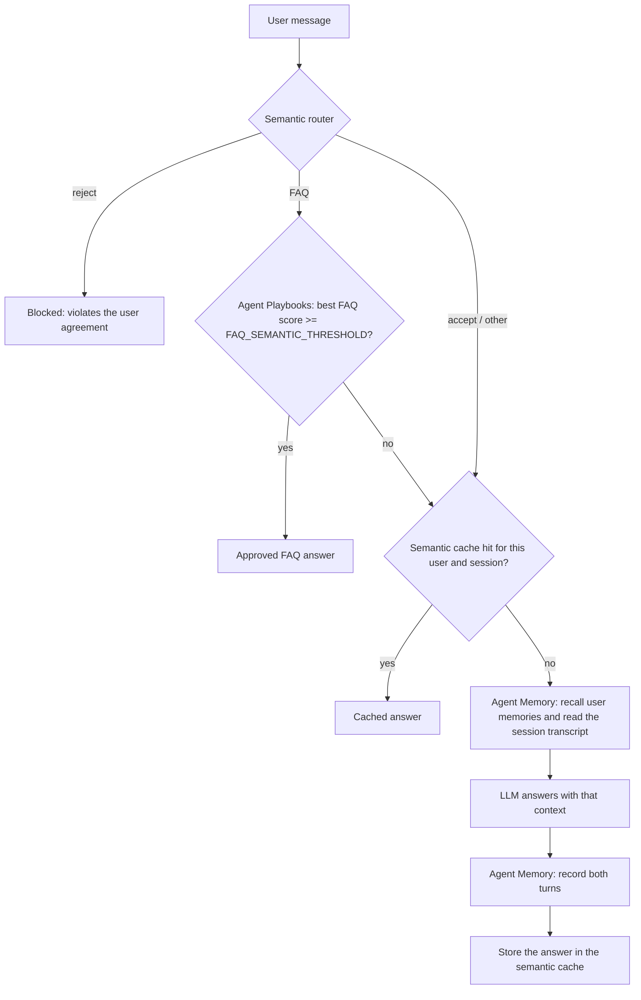

# IRIS Support Agent

A generic customer-support assistant driven by **Redis Iris** services. It answers common questions from an approved FAQ knowledge base without calling an LLM, blocks off-topic or disallowed requests, reuses earlier answers through a semantic cache, and otherwise asks an LLM, with long-term memory of each user and the session so far.

| Capability | Powered by |
|---|---|
| Approved FAQ answers, served without an LLM call | **Iris Agent Playbooks** |
| Long-term memory per user, and session history | **Iris Agent Memory** |
| Intent routing and guardrails (`FAQ` / `reject` / `accept`) | **RedisVL** semantic router |
| Reuse of earlier answers | **RedisVL** semantic cache |
| Answers that need reasoning (`gpt-4o`) | OpenAI, through LangChain |
| Chat UI and API | FastAPI + a single-page web UI |

## How a message is handled



1. **Semantic router** classifies the message. `reject` is answered with a fixed refusal. `FAQ` goes to the knowledge base. Everything else continues.
2. **FAQ knowledge base**: Agent Playbooks scores the question against the published FAQs. A match at or above `FAQ_SEMANTIC_THRESHOLD` is returned as is. Otherwise the question falls through.
3. **Semantic cache** returns a previous answer to a similar question, scoped to the same user and session (10-minute TTL).
4. **LLM with memory**: the user's message is recorded, relevant long-term memories are recalled, and the session transcript (summary first, then recent turns) is added to the system prompt. The answer is recorded back to the session and cached.

The UI shows where each answer came from: `LLM`, `Cached`, `FAQ` or `Blocked`.

If Agent Playbooks cannot be reached while a question is being answered, the FAQ lookup counts as a miss and the question continues to the cache and the LLM.

## Requirements

- Python 3.11+
- A Redis database reachable from the app (Redis Cloud Essentials or higher, or self-managed), used by RedisVL for the router and cache
- Redis Iris **Agent Memory** service: data-plane URL and Store ID
- Redis Iris **Agent Playbooks** service: URL and Playbook ID
- `IRIS_API_KEY`: one key for all Iris services. For Playbooks it must be allowed to read, write and publish FAQs, because the app syncs them at startup
- An OpenAI API key

## Setup

```bash
python -m venv venv
venv\Scripts\python.exe -m pip install -r requirements.txt   # Windows
# source venv/bin/activate && pip install -r requirements.txt  # macOS / Linux
```

Copy `.env.example` to `.env` and fill it in. Never commit `.env`.

| Variable | Purpose |
|---|---|
| `REDIS_DB_HOST`, `REDIS_DB_PORT`, `REDIS_DB_USER`, `REDIS_DB_PASSWORD` | Redis database for the semantic router and cache |
| `AGENT_MEMORY_URL`, `AGENT_MEMORY_STORE_ID` | Iris Agent Memory service |
| `AGENT_PLAYBOOKS_URL`, `AGENT_PLAYBOOKS_PLAYBOOK_ID` | Iris Agent Playbooks service |
| `IRIS_API_KEY` | API key shared by every Iris service |
| `OPENAI_API_KEY` | LLM access |
| `KNOWLEDGE_BASE_FILE` | FAQ source of truth (default `knowledge-base.json`) |
| `FAQ_SEMANTIC_THRESHOLD` | Minimum Playbook score (0 to 1) for serving a FAQ directly. Default `0.75` |
| `PLAYBOOK_FAQ_PRUNE` | `true` deletes Playbook FAQs that are no longer in the knowledge base file. Irreversible. Default `false` |
| `LLM_PROMPT`, `LLM_ROUTER_FILE` | System prompt file and router route definitions |

Any value may instead be the *name* of another environment variable that is set in your shell or host, such as a secret injected by a deployment platform. If that variable exists its value is used, otherwise the literal text is used.

## Run

Web UI:

```bash
venv\Scripts\python.exe -m uvicorn web_app:app --reload   # or run startup.bat
```

Open <http://localhost:8000>, enter a **Session** and **User** id, click **OK**, and start chatting.

Terminal chat (add `--demo` for a scripted conversation that seeds sample memories):

```bash
venv\Scripts\python.exe personal_assistant.py --user-id demo_user --session-id my-session
```

The first start downloads the embedding models, so it takes longer than later ones. Redis, the router and the cache come up first and the page then serves.

## The FAQ knowledge base

`knowledge-base.json` is the **source of truth**. It is a list of `prompt` / `response` pairs:

```json
{ "prompt": "Do you serve alcohol?", "response": "Yes, we serve beer, wine, and a selection of cocktails." }
```

On every startup, in the background, `playbook_faq.py` converts each entry to an Agent Playbooks FAQ and runs `iris agent-playbooks faqs sync --publish changed`:

- new or edited entries are created or versioned and published
- unchanged entries are left alone, so a restart is cheap
- the entry key comes from the question text, so editing a question creates a new entry
- entries you delete from the file stay in the Playbook unless `PLAYBOOK_FAQ_PRUNE=true`
- if the Playbook is unreachable, the sync retries and then logs an error in the server terminal. Already published FAQs keep serving either way

Check what is serving:

```bash
iris --json --no-input agent-playbooks faqs list --published
```

Tune `FAQ_SEMANTIC_THRESHOLD` against real scores. A close but unrelated question can score just above a low threshold and get the wrong approved answer, while a higher one sends more paraphrases to the LLM.

## Guardrails and routing

`semantic-routes.json` defines the routes by example phrases:

| Route | Effect |
|---|---|
| `FAQ` | Try the FAQ knowledge base first |
| `reject` | Refuse without calling any service |
| `accept` | Continue to the cache and the LLM |

Edit the `references` lists to change what is blocked or sent to the FAQ. The router is rebuilt from this file on every start.

## Memory

- Every turn is recorded as a session event in Iris Agent Memory. The service extracts long-term memories from sessions in the background, so new memories appear after its extraction window.
- Before answering, the app recalls the user's memories for the question and reads the session transcript.
- User and session ids are limited to letters, digits and hyphens, so other characters become `-` (`demo_user` is stored as `demo-user`).
- What is remembered, how long it is kept and what is excluded are service settings, configured in the Redis Cloud console.

## Project layout

| File | Role |
|---|---|
| `web_app.py` | FastAPI app: `GET /` serves the UI, `POST /chat` runs the pipeline above |
| `personal_assistant.py` | The agent (memory, LLM) and a terminal chat mode |
| `utils.py` | `SemanticWrapper` (router, cache, FAQ lookup) and environment handling |
| `playbook_faq.py` | Syncs `knowledge-base.json` to Agent Playbooks |
| `index.html` | Chat UI |
| `knowledge-base.json` | FAQ source of truth |
| `semantic-routes.json` | Router routes and example phrases |
| `llm_prompt` | System prompt for the LLM |
| `.claude/skills/` | The `add-agent-playbooks` and `add-agent-memory` skills used to build the integrations |

## Troubleshooting

- **The page loads slowly or not at all just after starting.** The app serves once Redis, the router and the cache are ready. Check the terminal for errors, and confirm the `REDIS_DB_*` settings reach your database.
- **`ConnectError` or `getaddrinfo failed` for a service host.** These are intermittent DNS or network failures. The FAQ sync retries on its own. Check your VPN or DNS if they persist.
- **A FAQ edit is not showing.** Look in the server terminal for `FAQ knowledge base was not synced`, then run the `faqs list --published` command above.
- **`ConfigurationError` from Agent Memory.** A URL, Store ID or `IRIS_API_KEY` is missing or empty. The message names which one.
- **`401` or `403` from an Iris service.** The `IRIS_API_KEY` was rejected, or it lacks a permission the app needs (Playbooks needs read, write and publish).
