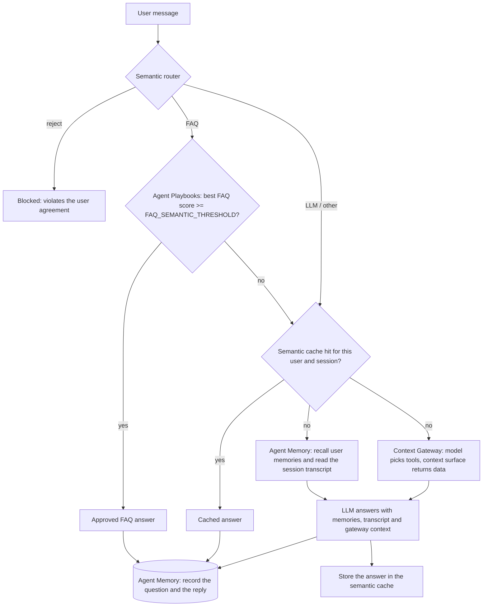

# IRIS Support Agent

A generic customer-support assistant driven by **Redis Iris** services. It answers common questions from an approved FAQ knowledge base without calling an LLM, blocks off-topic or disallowed requests, reuses earlier answers through a semantic cache, and otherwise asks an LLM, with long-term memory of each user and the session so far.

| Capability | Powered by |
|---|---|
| Approved FAQ answers, served without an LLM call | **Iris Agent Playbooks** |
| Long-term memory per user, and session history | **Iris Agent Memory** |
| Intent routing and guardrails (`FAQ` / `reject` / `LLM`) | **RedisVL** semantic router |
| Reuse of earlier answers | **RedisVL** semantic cache |
| Business data for the LLM, from the context surface | **Iris Context Gateway** |
| Answers that need reasoning (`gpt-4o`) | OpenAI, through LangChain |
| Chat UI and API | FastAPI + a single-page web UI |

## How a message is handled



1. **Semantic router** classifies the message. `reject` is answered with a fixed refusal. `FAQ` goes to the knowledge base. Everything else continues.
2. **FAQ knowledge base**: Agent Playbooks scores the question against the published FAQs. A match at or above `FAQ_SEMANTIC_THRESHOLD` is returned as is. Otherwise the question falls through.
3. **Semantic cache** returns a previous answer to a similar question, scoped to the same user and session (10-minute TTL). Set `ENABLE_SEMANTIC_CACHE=false` to switch it off; steps 2 and 4 then follow each other directly.
4. **LLM with memory and context**: the user's message is recorded, relevant long-term memories are recalled, and the session transcript (summary first, then recent turns) is added to the system prompt. At the same time, context is fetched from the context surface through the Context Gateway (see below). The answer is recorded back to the session and cached.
5. **What is recorded.** Answers from the FAQ, the cache and the LLM are recorded in Agent Memory as session events: the question and the reply. This keeps the transcript complete and lets the service extract memories from it. Each event carries the route that produced it (`faq`, `cache` or `llm`) as metadata, which the model never sees. **Blocked messages are never recorded**, neither the message nor the refusal. Recording an FAQ or cached reply is best effort: if Agent Memory is unavailable the error is logged and the reply is still returned.

The UI shows where each answer came from: `LLM`, `Cached`, `FAQ` or `Blocked`.

If Agent Playbooks cannot be reached while a question is being answered, the FAQ lookup counts as a miss and the question continues to the cache and the LLM.

## Context from the context surface

Every message that reaches the LLM also fetches context from a **Context Gateway** (`context_retriever.py`), the logic of the standalone Context Retriever tool:

1. A separate model call (`CONTEXT_GATEWAY_MODEL`) is shown the Gateway's tools and picks the ones that can answer the question, filling in their arguments only from what the question states. It also sees the user's recalled long-term memories and the last few turns of the session, so a follow-up such as "what about their positions?" can be resolved. If no tool applies, no context is added.
2. The chosen tools are called through the Gateway. A `filter_{entity}` tool (structured constraints) is always paired with its `search_{entity}_by_text` partner (free text), and the two result sets are intersected. If the two have nothing in common, the filter's results are returned instead, and if the filter returns nothing, the text search's results are. An entity whose `search_{entity}_by_text` tool lists no TEXT-indexed fields gets no text search: the tool is not offered to the model and the filter runs alone. The Gateway's tools are read once at startup, so restart the app after changing an index.
3. The results are added to the LLM prompt as a system message, capped at 8000 characters.

It runs after the memory lookup (the tool choice needs the memories), and adds a model call for the tool choice plus the tool calls, so LLM-routed answers are slower than before. FAQ, cache and blocked answers never touch the Gateway.

### Personal questions need an account number

A question about the user's own information or an entity related to them ("I cannot log into my account", "list all my positions", "how many Apple shares do I have?") is answered only for a known account:

1. A small yes/no model call classifies the question as personal or not. It runs in parallel with the tool choice. General or company-wide questions are never personal.
2. If it is personal and no account number is known, nothing is fetched, the LLM is told to ask the user for their account number, and that reply is **not** put in the semantic cache.
3. The account number is the latest one the user typed in the conversation (any `CONTEXT_UID_PATTERN` match), else one found in their recalled memories. The user can also give it in the same message.
4. Once known, the code, not the model, restricts every Gateway call to that account: it sets an `account_num` filter on every tool that supports one, turns `list_*` into a filtered call, allows a lookup by id only when the id is the account number, replaces `summarize_*` and `count_*`, which take no filter and cover every customer, with the user's own records (the answer then does the grouping or counting), and drops any other call it cannot restrict. An entity keyed by the account number, such as the customer profile with its status and notes, cannot be filtered by account, so a filter, search or count on it is replaced by fetching the user's own record with its `get_..._by_id` tool. A text search is only used together with an account-restricted filter. If the account has no matching records, the LLM is told so, rather than being shown anyone else's.
5. Replies built this way are not cached.

The account number is a lookup key, not a credential: nothing checks that the person typing it owns the account. Put real authentication in front of this before using it with real customer data.

Set `CONTEXT_GATEWAY_URL` to the Gateway's MCP endpoint; the call is authenticated with `IRIS_API_KEY`, which needs a use grant on the Gateway. With the property empty the feature is off. If the Gateway cannot be reached, the failure is logged and the question is answered without that context.

## Welcome message

When a chat starts (after the Session and User ids are confirmed, or at the start of the terminal chat) the assistant sends a welcome message by itself. The message asks the user for their UID, which is their account number. The user's reply sets what happens next:

1. If the reply contains an account number, alone or in a sentence such as "hi my account number is ACC000007", the app reads the long-term memories Agent Memory holds for the **user name entered in the UI** (the User field). The account number is not the lookup key, and nothing is read from the context surface, so the customer profile there is not consulted.
2. If there are long-term memories of type `semantic` (the lasting facts and preferences, not the episodic "on that day, the user asked..." events), the model writes a sentence or two from them about what the assistant knows about the user, for example "I can see that you plan to retire in about 10 years and would like an investment strategy focused on regular income." It does not summarize the conversation or repeat what the assistant said. That sentence goes into the welcome-back message. `WELCOME_MEMORY_TYPE` changes the memory type, and an empty value uses every type. If the model cannot be reached, the memories are listed instead (up to 10), and if none of them is a lasting fact about the user, the "nothing on file" message is sent.
3. If there are none, it replies with the message that asks the user to share their preferences and anything else they want remembered.
4. The exchange is recorded under the same user name. The account number is then part of the session, so later personal questions can be answered without asking for it again.

That reply gets only the welcome-back or preferences message, so a question in the same message is not answered: the user asks it next. If the first reply has no account number, it is handled as a normal message, and personal questions still ask for the account number when they need it. The account number is matched with `CONTEXT_UID_PATTERN`. If Agent Memory cannot be read, the failure is logged and the user gets the "nothing on file" message.

The texts live in files named in `.env`, so they can be reworded without touching code:

| File (default) | Sent | Placeholders |
|---|---|---|
| `welcome-message` | when the chat starts | none |
| `welcome-back-message` | when memories exist for the user name | `{memories}`: the sentence the model writes; `{user_id}`, `{account_num}` |
| `welcome-back-prompt` | (instructions for the model that writes `{memories}`) | none |
| `welcome-new-message` | when none exist | `{user_id}`, `{account_num}` |

Welcome files can use the `<prompt>file</prompt>` tag too (see Prompt files).

## Requirements

- Python 3.11+
- A Redis database reachable from the app (Redis Cloud Essentials or higher, or self-managed), used by RedisVL for the router and cache
- Redis Iris **Agent Memory** service: data-plane URL and Store ID
- Redis Iris **Agent Playbooks** service: URL and Playbook ID
- `IRIS_API_KEY`: one key for all Iris services. For Playbooks it must be allowed to read, write and publish FAQs, because the app syncs them at startup
- Optional: a Redis Iris **Context Gateway** with a context surface attached (its MCP endpoint)
- An OpenAI API key

## Setup

```bash
python -m venv venv
venv\Scripts\python.exe -m pip install -r requirements.txt   # Windows
# source venv/bin/activate && pip install -r requirements.txt  # macOS / Linux
```

Copy `.env.example` to `.env` and fill it in. Never commit `.env`.

| Variable | Purpose |
|---|---|
| `REDIS_DB_HOST`, `REDIS_DB_PORT`, `REDIS_DB_USER`, `REDIS_DB_PASSWORD` | Redis database for the semantic router and cache |
| `AGENT_MEMORY_URL`, `AGENT_MEMORY_STORE_ID` | Iris Agent Memory service |
| `AGENT_PLAYBOOKS_URL`, `AGENT_PLAYBOOKS_PLAYBOOK_ID` | Iris Agent Playbooks service |
| `CONTEXT_GATEWAY_URL` | MCP endpoint of the Iris Context Gateway. Empty disables context retrieval |
| `CONTEXT_GATEWAY_MODEL` | OpenAI model that picks the Gateway tools and classifies personal questions. Default `gpt-4o-mini` |
| `CONTEXT_UID_PATTERN` | Regular expression that recognises an account number in what the user types. Default `ACC\d{6}` |
| `CONTEXT_ACCOUNT_FIELD` | Gateway field that holds the account number. Default `account_num` |
| `IRIS_API_KEY` | API key shared by every Iris service |
| `OPENAI_API_KEY` | LLM access |
| `KNOWLEDGE_BASE_FILE` | FAQ source of truth (default `knowledge-base.json`) |
| `LOG_LEVEL` | `DEBUG`, `INFO`, `WARNING`, `ERROR` or `CRITICAL` (the most severe, and the default). The application then logs only that level and above, so at the default failures such as a FAQ sync or Agent Memory error are not logged. The web server's own lines (startup, one line per request) and the recalled-memory lines follow it too, so at the default the terminal stays silent; use `INFO` to see them |
| `ENABLE_SEMANTIC_CACHE` | `true` (default) reuses earlier answers to similar questions. `false` turns the semantic cache off: no cache index is created and every question that reaches the LLM step is answered fresh |
| `SUBJECT_ID` | Which subject's FAQs this application answers from (see below). Empty uses every FAQ in the Playbook |
| `FAQ_SEMANTIC_THRESHOLD` | Minimum Playbook score (0 to 1) for serving a FAQ directly. Default `0.75` |
| `PLAYBOOK_FAQ_PRUNE` | `true` deletes Playbook FAQs that are no longer in the knowledge base file (only for the subjects named in it, when it has any). Irreversible. Default `false` |
| `WELCOME_MESSAGE_FILE`, `WELCOME_BACK_MESSAGE_FILE`, `WELCOME_NEW_MESSAGE_FILE` | Files holding the welcome texts (see below). An empty `WELCOME_MESSAGE_FILE` turns the welcome flow off |
| `WELCOME_BACK_PROMPT_FILE` | Instructions for the model that writes the welcome-back sentence |
| `WELCOME_MEMORY_TYPE` | Memory type listed in the welcome-back message. Default `semantic`; empty lists every type |
| `LLM_PROMPT`, `LLM_ROUTER_FILE` | System prompt file and router route definitions |
| `LLM_TOOL_SELECTOR_PROMPT` | File with the tool selector's system prompt, the rules for choosing Gateway tools. Default `llm-prompt-tool-selector` |

Any value may instead be the *name* of another environment variable that is set in your shell or host, such as a secret injected by a deployment platform. If that variable exists its value is used, otherwise the literal text is used.

## Run

Web UI:

```bash
venv\Scripts\python.exe -m uvicorn web_app:app --reload   # or run startup.bat
```

Open <http://localhost:8000>, enter a **Session** and **User** id, click **OK**, and start chatting.

Terminal chat (add `--demo` for a scripted conversation that seeds sample memories):

```bash
venv\Scripts\python.exe personal_assistant.py --user-id demo_user --session-id my-session
```

The first start downloads the embedding models, so it takes longer than later ones. Redis, the router and the cache come up first and the page then serves.

## The FAQ knowledge base

`knowledge-base.json` is the **source of truth**. It is a list of `prompt` / `response` pairs:

```json
{ "prompt": "Do you serve alcohol?", "response": "Yes, we serve beer, wine, and a selection of cocktails." }
```

Each entry may carry an `attributes` object. Its `subject_id` says which subject the entry belongs to, and the whole object travels with the FAQ into the Playbook:

```json
{ "prompt": "What is an ETF", "response": "...", "attributes": { "subject_id": "finance" } }
```

One file can hold several subjects. Every entry is loaded, and the app answers only from the subject named by `SUBJECT_ID` (see below).

On every startup, in the background, `playbook_faq.py` converts each entry to an Agent Playbooks FAQ and runs `iris agent-playbooks faqs sync --publish changed`:

- new or edited entries are created or versioned and published
- unchanged entries are left alone, so a restart is cheap
- the entry key comes from the question text, so editing a question creates a new entry
- entries you delete from the file stay in the Playbook unless `PLAYBOOK_FAQ_PRUNE=true`
- if the Playbook is unreachable, the sync retries and then logs an error in the server terminal. Already published FAQs keep serving either way

### Subjects: several sets of FAQs in one Playbook

Entries in `knowledge-base.json` name their subject in `attributes.subject_id` (for example `finance` or `insurance`). All of them are loaded into the Playbook, and each application chooses its own with `SUBJECT_ID` in `.env`:

- a lookup only considers FAQs whose `subject_id` equals `SUBJECT_ID`, so two applications can share one Playbook, or one file can serve both, each seeing only its own subject;
- an entry key starts with a short prefix derived from the entry's subject (for example `eab762a0-what-is-an-etf`), so two subjects can hold the same question without overwriting each other;
- `PLAYBOOK_FAQ_PRUNE=true` deletes only FAQs of the subjects named in the file that are no longer in it. Entries of other subjects in a shared Playbook are never touched. If the file names no subject at all, it deletes every remote-only FAQ in the Playbook instead, so do not use it on a shared Playbook;
- an entry without a `subject_id` is loaded unlabelled and is never found while `SUBJECT_ID` is set (the app logs a warning);
- with `SUBJECT_ID` empty, nothing is filtered and the lookup uses the whole Playbook.

After you change `SUBJECT_ID`, restart the app. Entries created under an older labelling scheme stay in the Playbook until you delete them with `iris agent-playbooks faqs delete <entry-key> --yes`.

Check what is serving:

```bash
iris --json --no-input agent-playbooks faqs list --published
```

Tune `FAQ_SEMANTIC_THRESHOLD` against real scores. A close but unrelated question can score just above a low threshold and get the wrong approved answer, while a higher one sends more paraphrases to the LLM.

## Guardrails and routing

`semantic-routes.json` defines the routes by example phrases:

| Route | Effect |
|---|---|
| `FAQ` | Try the FAQ knowledge base first |
| `reject` | Refuse without calling any service |
| `LLM` | Continue to the cache and the LLM |

Edit the `references` lists to change what is blocked or sent to the FAQ. The router is rebuilt from this file on every start.

## Memory

- Answers from the FAQ, the cache and the LLM are recorded as session events in Iris Agent Memory, tagged with their route. Blocked messages are not recorded. The service extracts long-term memories from sessions in the background, so new memories appear after its extraction window.
- Before answering, the app recalls the user's memories for the question and reads the session transcript.
- User and session ids are limited to letters, digits and hyphens, so other characters become `-` (`demo_user` is stored as `demo-user`).
- What is remembered, how long it is kept and what is excluded are service settings, configured in the Redis Cloud console.

## Prompt files

The prompt files (`llm_prompt`, `llm-prompt-tool-selector`) can pull in other files with a `<prompt>` tag:

```text
<prompt>llm-prompt-context-retrieval</prompt>
```

The tag is replaced by the content of the named file when the app starts. The name is relative to the file that contains the tag, or an absolute path. Included files can include others (up to five levels). A missing file, a circular include or an empty prompt stops the app at startup with an error that names the file. Edit a prompt file, then restart the app.

## Project layout

| File | Role |
|---|---|
| `web_app.py` | FastAPI app: `GET /` serves the UI, `POST /chat` runs the pipeline above |
| `personal_assistant.py` | The agent (memory, LLM) and a terminal chat mode |
| `utils.py` | `SemanticWrapper` (router, cache, FAQ lookup) and environment handling |
| `playbook_faq.py` | Syncs `knowledge-base.json` to Agent Playbooks |
| `context_retriever.py` | Fetches context from the Context Gateway for LLM-routed messages |
| `index.html` | Chat UI |
| `knowledge-base.json` | FAQ source of truth |
| `semantic-routes.json` | Router routes and example phrases |
| `llm_prompt` | System prompt for the LLM. Includes `llm-prompt-context-retrieval` |
| `llm-prompt-context-retrieval` | The part of the prompt on how to use retrieved context and when to ask for the account number |
| `llm-prompt-tool-selector` | System prompt for the Gateway tool selector |
| `welcome-message`, `welcome-back-message`, `welcome-new-message`, `welcome-back-prompt` | Texts of the welcome flow |
| `.claude/skills/` | The `add-agent-playbooks` and `add-agent-memory` skills used to build the integrations |

## Troubleshooting

- **The page loads slowly or not at all just after starting.** The app serves once Redis, the router and the cache are ready. Check the terminal for errors, and confirm the `REDIS_DB_*` settings reach your database.
- **`ConnectError` or `getaddrinfo failed` for a service host.** These are intermittent DNS or network failures (the computer could not look up the host name). The FAQ sync retries on its own, and calls to Agent Memory, the Context Gateway and the FAQ lookup are retried a few times with short waits, logging one warning line per retry. A traceback appears only when every attempt fails. If it persists, run `ipconfig /flushdns` and check your VPN or DNS.
- **A FAQ edit is not showing.** Set `LOG_LEVEL=ERROR` (the default `CRITICAL` hides it), restart, and look in the server terminal for `FAQ knowledge base was not synced`, then run the `faqs list --published` command above.
- **`ConfigurationError` from Agent Memory.** A URL, Store ID or `IRIS_API_KEY` is missing or empty. The message names which one.
- **`401` or `403` from an Iris service.** The `IRIS_API_KEY` was rejected, or it lacks a permission the app needs (Playbooks needs read, write and publish).
